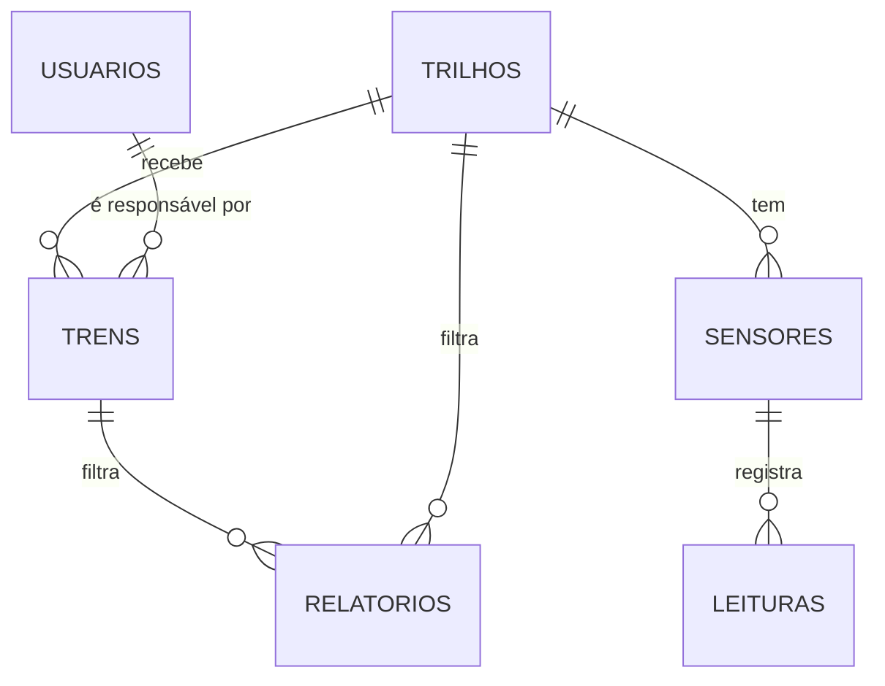

# FerroMonitor

Sistema web de monitoramento ferroviário, desenvolvido na Situação de Aprendizagem **Ferroramas** do curso Técnico em Desenvolvimento de Sistemas integrado ao Ensino Médio (EMDS 2026), na Escola SESI SENAI.

**Equipe:**

- Caio Marques
- Lucas Lazzarotti
- Luis Pedro Mathias
- Matheus Guesser

**Links:** [Repositório](https://github.com/Lazzarott1/sa-ferrorama) · [Quadro Kanban](https://github.com/users/Lazzarott1/projects/3) · [Manual de utilização](doc/manual-de-utilizacao.md)

## O que é

O FerroMonitor reúne em um só lugar o cadastro da malha ferroviária (trilhos, trens e sensores), as leituras dos sensores em tempo real e os relatórios da operação. A ideia é que a equipe que cuida da ferrovia veja o que está acontecendo e aja antes que um problema vire acidente.

## Funcionalidades

- **Landing page** (`index.html`): apresenta o sistema e leva para o login.
- **Login** com nome de usuário e senha. As senhas ficam salvas com hash (`password_hash`). O erro aparece num aviso no canto da tela, que some sozinho.
- **Dois perfis**:
  - **Administrador**: cadastra, edita, ativa e inativa tudo, e é o único que vê a tela de Usuários.
  - **Operador**: consulta as telas, acompanha o Dashboard e gera relatórios, mas não altera cadastros.
- **Navbar** com as abas, a etiqueta com o nome e o perfil de quem está logado e o botão **Sair**, que pede confirmação antes de encerrar a sessão.
- **Home**: saudação, data, resumo da operação (trens, trilhos, sensores ativos e sensores em alerta), clima atual em Joinville (API Open-Meteo), atalhos para as telas e o circuito animado da ferrovia.
- **Dashboard**: última leitura de cada sensor ativo, resumo de leituras e alertas e a tabela das últimas 100 leituras. A tela se atualiza sozinha a cada 3 segundos.
- **Sensores, Trens, Trilhos e Usuários**: listagem com filtro Ativos / Inativos / Todos, cadastro pelo botão "+ NOVO", edição na própria linha da tabela, ativar/inativar um item ou vários de uma vez (caixas de seleção).
- **Trilhos** fazem o papel das rotas: nome, descrição, distância em km, status e a localização da estação, com o endereço preenchido pelo CEP (API ViaCEP).
- **Trens** são de passageiros ou de carga (a capacidade muda para passageiros ou kg), ficam num trilho e têm um usuário responsável.
- **Relatórios**: geração com título, período, trem, trilho e tipo de dado. O relatório abre numa janela com o resumo, os trens, trilhos e sensores filtrados e as leituras do período.

## Regras principais

- **Nada é apagado do banco.** O registro fica "INATIVO" e pode ser visto e reativado pelo filtro.
- **Todo trem precisa de um trilho e de um responsável**, e todo sensor precisa de um trilho.
- **Trilho com trens ou sensores ativos não pode ser inativado**, e usuário responsável por trens ativos também não. O sistema mostra o motivo e bloqueia a ação.
- **O administrador não pode inativar a própria conta nem mudar o próprio perfil**, para o sistema nunca ficar sem administrador.
- **Usuário inativo não entra.** Se estiver com a sessão aberta, é desconectado na próxima tela que abrir.
- **As permissões são conferidas no PHP de cada página.** Um operador que digita o endereço da tela de Usuários volta para a Home com o aviso "Você não tem permissão para acessar essa tela".

## Como rodar

Usamos o **XAMPP** (Apache + MySQL) com PHP 8. O computador precisa de internet para o Bootstrap, os ícones, o clima e o CEP.

1. Coloque a pasta do projeto em `C:\xampp\htdocs\` com o nome `sa-ferrorama`.
2. Abra o XAMPP e ligue o **Apache** e o **MySQL**.
3. No phpMyAdmin (`http://localhost/phpmyadmin`), importe `database/db_sa.sql`. Ele cria o banco `sa_ferrorama`, as tabelas e os usuários de teste.
4. Acesse `http://localhost/sa-ferrorama/`. A landing page abre; clique em **Acessar o sistema**.

Se o seu MySQL tiver senha, ajuste em `infra/conexao.php`.

### Usuários de teste

| Usuário  | Senha       | Perfil        |
|----------|-------------|---------------|
| admin    | admin123    | Administrador |
| operador | operador123 | Operador      |

### Primeiro uso

O banco começa só com os dois usuários. Entre como `admin` e cadastre, nesta ordem: um trilho, um trem (escolhendo o trilho e o responsável) e um sensor no trilho.

Enquanto o protótipo da ferrovia não está ligado ao sistema, dá para testar o Dashboard inserindo leituras pelo phpMyAdmin:

```sql
INSERT INTO leituras (id_sensor, valor) VALUES (1, 35.5);
```

### Se der problema

- **A importação diz que o banco já existe:** apague o banco `sa_ferrorama` antigo e importe de novo (isso apaga os dados dele).
- **Telas sem estilo ou sem ícones:** o Bootstrap vem pela internet; confira a conexão.
- **Clima ou CEP não carregam:** as APIs também precisam de internet. O CEP pode ser preenchido à mão.
- **Erro na conexão com o banco:** confira se o MySQL está ligado e se os dados de `infra/conexao.php` estão certos.

## Banco de dados

O banco `sa_ferrorama` tem seis tabelas:



| Tabela       | O que guarda                                                        | Status                     |
|--------------|---------------------------------------------------------------------|----------------------------|
| `usuarios`   | Nome de usuário, e-mail, senha com hash, perfil e data de cadastro  | Ativo, Inativo             |
| `trilhos`    | Nome, descrição, km, endereço da estação (CEP) e data de criação    | Ativo, Manutenção, Inativo |
| `trens`      | Nome, modelo, capacidade, trilho e usuário responsável              | Ativo, Manutenção, Inativo |
| `sensores`   | Nome, tipo (velocidade, localização ou temperatura) e trilho        | Ativo, Alerta, Inativo     |
| `leituras`   | Sensor, valor medido e data e hora da leitura                       | -                          |
| `relatorios` | Título, tipo, período, filtros e data de geração                    | Pronto                     |

## APIs externas

| API        | Onde é usada           | Para quê                                        |
|------------|------------------------|-------------------------------------------------|
| Open-Meteo | Home (`script/clima.js`) | Clima atual em Joinville, atualizado a cada 10 min |
| ViaCEP     | Trilhos (`script/cep.js`) | Preencher o endereço da estação pelo CEP       |

Detalhes em [`doc/apis-externas.md`](doc/apis-externas.md).

## Como o projeto está organizado

```
index.html      landing page
database/       script do banco (db_sa.sql)
doc/            manual, pesquisas da equipe, APIs, uso de IA e validações
infra/
  conexao.php             conexão com o banco
  validacoes-crud/        validações de trens, trilhos, sensores e leituras
  validacoes-usuarios/    controle de login, de administrador e logout
public/         telas do sistema
  tela-login.php          login
  tela-geral-home.php     home
  navbar.php              menu superior e confirmação de saída
  listagem.php            funções comuns das listas (filtro, ativar/inativar)
  dashboard/  relatorios/  sensores/  trens/  trilhos/  usuarios/
script/         JavaScript (login, clima, CEP, mapa, dashboard, capacidade)
assets/         CSS e imagens
```

## Sensores e ferrovia física

Planejamos um protótipo para ligar o sistema à ferrovia montada pela turma, que tem uma linha principal, uma passagem de nível, um trecho elevado com ponte, dois desvios e um desvio morto. Esse protótipo ainda não está integrado ao sistema.

- **Sensores:** 15 na via: 10 ultrassônicos HC-SR04, 2 chaves de fim de curso, acelerômetro MPU-6050, sensor de corrente INA219 e termistor NTC 10k.
- **Atuadores:** 7 na via (4 servos SG90 para desvios e cancelas, 1 buzzer com LED e 2 semáforos) e 1 driver de motor DRV8833 em cada trem.
- **Controle:** um ESP32 na mesa cuida da via, com um módulo PCA9685 para os servos e LEDs, e um ESP32-C3 dentro de cada trem controla o motor.
- **Alertas previstos:** velocidade acima de 40 cm/s, pilha abaixo de 2,2 V, motor acima de 50 °C ou inclinação acima de 30°.

## Implantação

Escolhemos a **implantação piloto**: o sistema começa em um trecho e só depois vai para o resto da ferrovia.

1. Escolher um trilho de cerca de 20 km, com tráfego moderado.
2. Ligar o sistema só nesse trecho, cadastrando seus sensores e trens.
3. Manter o controle atual, com os operadores conferindo se os alertas batem com a realidade.
4. Avaliar por 1 mês as falhas dos sensores, os alertas falsos, o tempo de resposta e o uso das telas.
5. Expandir trecho por trecho.

## Próximos passos

- Ligar o protótipo ao sistema para os sensores gravarem as leituras sozinhos.
- Marcar o sensor como "ALERTA" automaticamente quando a leitura passar do limite e mostrar o aviso em pop-up.
- Permitir baixar os relatórios.
- Encerrar a sessão após 30 minutos sem uso.

## Tecnologias

PHP 8, MySQL/MariaDB, HTML, CSS, JavaScript, Bootstrap 5.3 e Bootstrap Icons. Para organizar o trabalho usamos Scrum e um quadro Kanban no GitHub Projects.
