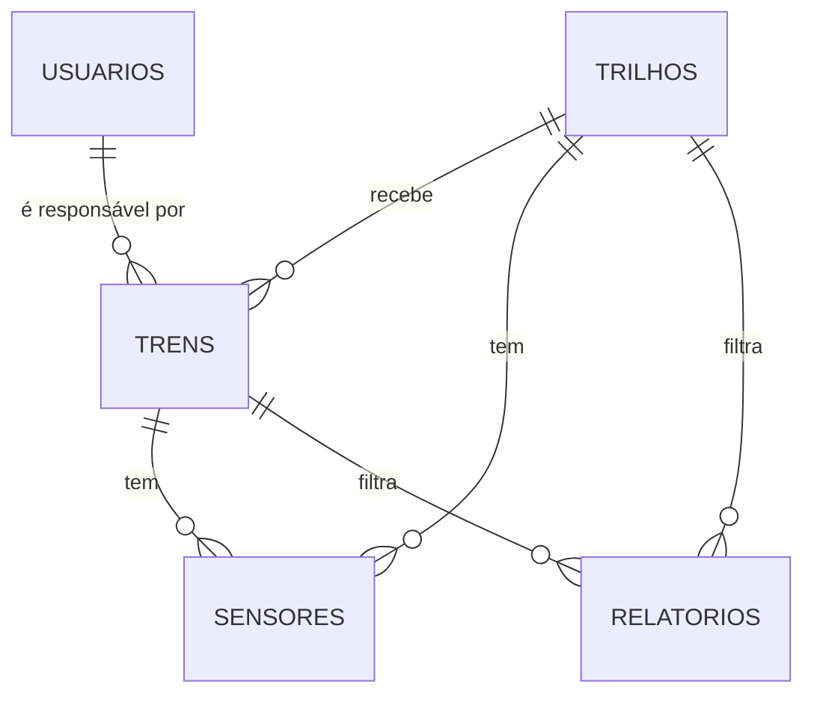

# FerroMonitor

Sistema web de monitoramento ferroviário, desenvolvido na Situação de Aprendizagem **Ferroramas** do curso Técnico em Desenvolvimento de Sistemas integrado ao Ensino Médio (EMDS 2026), na Escola SESI SENAI.

**Equipe:**

- Caio Marques
- Lucas Lazzarotti
- Luis Pedro Mathias
- Matheus Guesser

**Links:** [Repositório](https://github.com/Lazzarott1/sa-ferrorama) · [Quadro Kanban](https://github.com/users/Lazzarott1/projects/3)

## O que é

O FerroMonitor é um sistema web para gerenciar uma ferrovia. A ideia é que os trens e os trilhos tenham sensores, e que a equipe que cuida da ferrovia consiga cadastrar e acompanhar tudo isso em um só lugar.

O objetivo final do projeto é receber dos sensores dados de velocidade, localização, temperatura, consumo de energia e falhas, mostrar tudo em dashboards e relatórios, e avisar a equipe quando houver falha ou algum limite for ultrapassado.

Hoje o sistema faz o gerenciamento dos cadastros (usuários, trens, trilhos e sensores), tem login com controle de acesso e gera relatórios com a situação desses cadastros. A leitura dos sensores em tempo real ainda é plano para as próximas etapas.

## Funcionalidades

- **Login** com nome de usuário e senha. As senhas ficam salvas com hash no banco (`password_hash`), nunca em texto puro.
- **Dois perfis**:
- **Administrador**: pode cadastrar, editar e inativar tudo, e é o único que vê a tela de usuários.
- **Operador**: consulta as informações e gera relatórios, mas não altera nenhum cadastro.
- **Home**: mostra a saudação, a data e um mapa animado do traçado da ferrovia. O trem do mapa é só uma animação, não a posição real.
- **Usuários**: cadastro, listagem, edição e inativação (só o administrador). É aqui também que o administrador define uma nova senha para quem esqueceu a sua.
- **Trens**: cadastro, listagem, edição e inativação. Cada trem é de passageiros ou de carga, tem um usuário responsável e fica ligado a um trilho. A capacidade é informada em passageiros ou em kg, conforme o modelo.
- **Trilhos**: cadastro, listagem, edição e inativação. No nosso sistema, os trilhos fazem o papel das rotas: cada um tem nome, descrição, distância em km e data de criação.
- **Sensores**: cadastro, listagem, edição e inativação. Cada sensor é da categoria Trem ou Trilho, fica ligado a um trem ou a um trilho e mede velocidade, localização ou temperatura.
- **Relatórios**: geração com título, período, trem, trilho e tipo de dado, além da lista dos relatórios já gerados com filtro por tipo. Como as leituras dos sensores ainda não são salvas, o relatório mostra a situação atual de trens, trilhos e sensores, e o período fica apenas registrado nele.
- **Logout**: pelo botão "Sair", que encerra a sessão.

## Regras principais

- **Nada é apagado do banco.** Em vez de excluir, o registro fica como "inativo" e pode ser visto pelo filtro Ativos / Inativos / Todos. Para reativar, basta editar o registro e mudar o status.
- **A ordem de cadastro é trilho, trem e sensor**, porque todo trem precisa de um trilho e todo sensor precisa de um trilho ou de um trem.
- **Um trilho com trens ou sensores ativos não pode ser inativado**, e um trem com sensores ativos também não. O sistema mostra o aviso com as ligações e bloqueia a ação.
- **Antes de inativar um sensor**, o sistema mostra a qual trem ou trilho ele está ligado e pede confirmação.
- **Um administrador não pode inativar a própria conta nem mudar o próprio perfil**, para o sistema nunca ficar sem administrador.
- **Usuário inativo não entra no sistema.** Se ele estiver com a sessão aberta, é desconectado na próxima tela que abrir.

As permissões são conferidas no PHP de cada página. Então, mesmo que um operador digite o endereço de uma página de administrador, ele é mandado de volta para a Home.

A documentação completa do projeto tem 45 regras de negócio, 46 requisitos funcionais e 12 requisitos não funcionais.

## Como rodar

Usamos o **XAMPP** (Apache + MySQL) com PHP 8. Testamos com PHP 8.3 e MariaDB 10.11.

1. Coloque a pasta do projeto dentro de `C:\xampp\htdocs\`, com o nome `sa-ferrorama`.
2. Abra o XAMPP e ligue o **Apache** e o **MySQL**.
3. No phpMyAdmin (`http://localhost/phpmyadmin`), importe o arquivo `database/db_sa.sql`. Ele cria o banco `sa_teste` com as tabelas e os usuários de teste.
4. Acesse `http://localhost/sa-ferrorama/` no navegador. Ele já abre a tela de login.

Se o seu MySQL tiver senha, ajuste em `infra/conexao.php`.

### Usuários de teste

| Usuário  | Senha       | Perfil        |
|----------|-------------|---------------|
| admin    | admin123    | Administrador |
| operador | operador123 | Operador      |

### Primeiro uso

O banco começa só com os dois usuários acima. Para testar o sistema, entre como `admin` e cadastre, nessa ordem, um trilho, um trem e um sensor.

### Se der problema

- **A importação diz que o banco já existe:** apague o banco `sa_teste` antigo no phpMyAdmin e importe de novo. Isso apaga os dados que estavam nele.
- **As telas aparecem sem estilo:** o Bootstrap é carregado pela internet, então o computador precisa estar conectado.
- **Erro na conexão com o banco:** confira se o MySQL está ligado no XAMPP e se os dados de `infra/conexao.php` estão certos.

## Banco de dados

O banco `sa_teste` tem cinco tabelas:



| Tabela       | O que guarda                                                      | Status                         |
|--------------|-------------------------------------------------------------------|--------------------------------|
| `usuarios`   | Nome de usuário, e-mail, senha com hash, perfil e data de cadastro | Ativo, Inativo                 |
| `trilhos`    | Nome, descrição, distância em km e data de criação                | Ativo, Manutenção, Inativo     |
| `trens`      | Nome, modelo, capacidade, trilho e usuário responsável            | Ativo, Manutenção, Inativo     |
| `sensores`   | Nome, categoria, tipo e o trem ou trilho ligado a ele             | Ativo, Alerta, Inativo         |
| `relatorios` | Título, tipo, período, filtros e data de geração                  | Processando, Pronto, Erro      |

## Como o projeto está organizado

```
database/   script do banco (db_sa.sql)
doc/        pesquisas da equipe (Scrum, CRUD, APIs, PDO, XAMPP, identidade visual) e validações
infra/
  conexao.php             conexão com o banco
  validacoes-crud/        validações de trens, trilhos e sensores
  validacoes-usuarios/    controle de login, de administrador e logout
public/     as telas do sistema
  tela-login.php          login
  tela-geral-home.php     home
  navbar.php              menu superior
  relatorios/  sensores/  trens/  trilhos/  usuarios/
script/     JavaScript das telas
assets/     CSS e imagens
index.html  redireciona para a tela de login
```

## Sensores e ferrovia física

Planejamos um protótipo para ligar o sistema à ferrovia montada pela turma, que tem uma linha principal, uma passagem de nível, um trecho elevado com ponte, dois desvios e um desvio morto. Esse protótipo ainda não está integrado ao sistema.

- **Sensores:** com um trem, são 15 no total. Na via ficam 12 (10 ultrassônicos HC-SR04 e 2 chaves de fim de curso), e cada trem leva 3 (acelerômetro MPU-6050, sensor de corrente INA219 e termistor NTC 10k).
- **Atuadores:** com um trem, são 8. Na via ficam 7 (4 servos SG90 para desvios e cancelas, 1 buzzer com LED e 2 semáforos), e cada trem leva 1 driver de motor DRV8833.
- **Controle:** um ESP32 na mesa cuida da via, com um módulo PCA9685 para os servos e os LEDs, e um ESP32-C3 dentro de cada trem controla o motor. O controle de velocidade fica no trem porque ele anda a pilha, sem energia pelo trilho.
- **Alertas previstos:** velocidade acima de 40 cm/s, pilha abaixo de 2,2 V, motor acima de 50 °C ou inclinação acima de 30°.

Se a conexão cair, a ideia é que os sensores guardem as leituras e as enviem quando ela voltar.

## Implantação

Escolhemos a **implantação piloto**: o sistema começa em um trecho e só depois vai para o resto da ferrovia. Assim, uma falha atinge só aquele trecho, e os sensores são testados em condições reais.

1. Escolher um trilho de cerca de 20 km, com tráfego moderado.
2. Ligar o sistema só nesse trecho, cadastrando seus sensores e os trens que passam por ele.
3. Manter o controle atual, com os operadores conferindo se os alertas batem com a realidade.
4. Avaliar por 1 mês as falhas dos sensores, os alertas falsos, o tempo de resposta e o uso das telas.
5. Expandir o sistema trecho por trecho.

## Validação

As validações da listagem e da inativação de usuários (V1 a V21) estão em [`doc/validações-usuarios.md`](doc/valida%C3%A7%C3%B5es-usuarios.md), com o passo a passo e o resultado esperado de cada uma.

## Próximos passos

- Salvar as leituras dos sensores no banco e ligar o protótipo ao sistema.
- Criar o dashboard e a tela de monitoramento em tempo real.
- Mostrar alertas em pop-up quando houver falha ou limite ultrapassado.
- Fazer os relatórios usarem as leituras do período escolhido e permitir o download.
- Adicionar na tela de sensores a pesquisa por nome, os filtros por categoria e tipo e a janela de detalhes.
- Encerrar a sessão após 30 minutos sem uso.

## Tecnologias

PHP, MySQL, HTML, CSS, JavaScript e Bootstrap 5. Para organizar o trabalho usamos Scrum e um quadro Kanban no GitHub Projects.